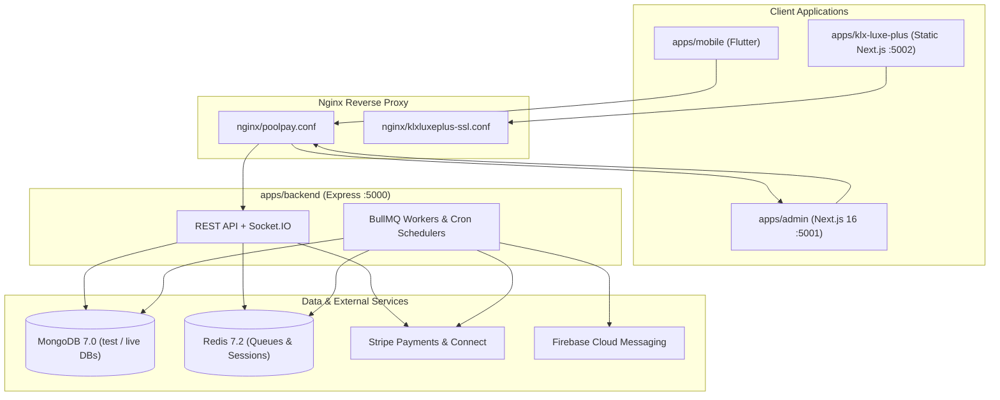

# Comprehensive Full-Project Review: PoolPay Monorepo (`derival81`)

## Executive Overview

This report synthesizes a full-stack, multi-dimensional audit across all workspaces and infrastructure in the PoolPay Turborepo monorepo:

- **Backend API & Workers**: [`apps/backend`](file:///c:/Users/Adnan/ZProject/adnan/derival81/apps/backend/package.json) (Express.js, TypeScript, Mongoose, BullMQ, Stripe, Socket.IO)
- **Admin Dashboard & Legal Hub**: [`apps/admin`](file:///c:/Users/Adnan/ZProject/adnan/derival81/apps/admin/package.json) (Next.js 16.1.6 App Router, React 19, Tailwind CSS 4)
- **KLX Marketing App**: [`apps/klx-luxe-plus`](file:///c:/Users/Adnan/ZProject/adnan/derival81/apps/klx-luxe-plus/package.json) (Standalone Next.js 16 static export for KLX LUXE PLUS LLC)
- **Mobile App**: [`apps/mobile`](file:///c:/Users/Adnan/ZProject/adnan/derival81/apps/mobile/pubspec.yaml) (Flutter cross-platform app with GetX, Stripe, IAP, Socket.IO, FCM)
- **Shared Workspace Packages**: [`packages/types`](file:///c:/Users/Adnan/ZProject/adnan/derival81/packages/types/package.json), [`packages/validators`](file:///c:/Users/Adnan/ZProject/adnan/derival81/packages/validators/package.json), [`packages/ui`](file:///c:/Users/Adnan/ZProject/adnan/derival81/packages/ui/package.json), [`packages/eslint-config`](file:///c:/Users/Adnan/ZProject/adnan/derival81/packages/eslint-config/package.json), [`packages/tsconfig`](file:///c:/Users/Adnan/ZProject/adnan/derival81/packages/tsconfig/package.json)
- **DevOps & Infrastructure**: [`.github/workflows`](file:///c:/Users/Adnan/ZProject/adnan/derival81/.github/workflows/deploy.yml), [`deploy/`](file:///c:/Users/Adnan/ZProject/adnan/derival81/deploy/deploy.sh), [`nginx/`](file:///c:/Users/Adnan/ZProject/adnan/derival81/nginx/poolpay.conf), [`docker-compose.prod.yml`](file:///c:/Users/Adnan/ZProject/adnan/derival81/docker-compose.prod.yml), [`scripts/`](file:///c:/Users/Adnan/ZProject/adnan/derival81/scripts/backup-mongodb.sh)

### Summary of Findings by Severity

| Severity          | Backend | Frontend & Packages | Mobile (Flutter) | DevOps & Infra | Total  |
| :---------------- | :-----: | :-----------------: | :--------------: | :------------: | :----: |
| **Critical (P0)** |    9    |          4          |        5         |       7        | **25** |
| **High (P1)**     |   11    |          6          |        5         |       8        | **30** |
| **Medium (P2)**   |    8    |          4          |        4         |       7        | **23** |
| **Low (P3)**      |    7    |          3          |        3         |       4        | **17** |

> [!CAUTION]
> **Immediate Production Blockers Identified**:
>
> 1. **Backend crashes on boot in production** due to a missing module import (`./app/jobs/redistribution.worker`) in [`server.ts`](file:///c:/Users/Adnan/ZProject/adnan/derival81/apps/backend/src/server.ts#L101).
> 2. **Privilege escalation & self-KYC verification** on `PATCH /api/v1/user/profile` ([`validateRequest.ts`](file:///c:/Users/Adnan/ZProject/adnan/derival81/apps/backend/src/app/middlewares/validateRequest.ts#L8-L12) + [`user.service.ts`](file:///c:/Users/Adnan/ZProject/adnan/derival81/apps/backend/src/app/modules/user/user.service.ts#L112-L156)).
> 3. **Financial ledger desync & double-charging** in Stripe payment/webhook handling ([`paymentRetry.job.ts`](file:///c:/Users/Adnan/ZProject/adnan/derival81/apps/backend/src/app/jobs/paymentRetry.job.ts#L106-L207), [`webhook.service.ts`](file:///c:/Users/Adnan/ZProject/adnan/derival81/apps/backend/src/app/modules/webhook/webhook.service.ts#L89-L168), [`reconciliation.worker.ts`](file:///c:/Users/Adnan/ZProject/adnan/derival81/apps/backend/src/app/jobs/reconciliation.worker.ts#L58-L68)).
> 4. **Admin auth bypass via `?demo=true`** in [`apps/admin/app/dashboard/layout.tsx`](file:///c:/Users/Adnan/ZProject/adnan/derival81/apps/admin/app/dashboard/layout.tsx#L17-L35) and **backend 2FA bypass** via `isDashboardLogin` / browser `User-Agent` in [`auth.controller.ts`](file:///c:/Users/Adnan/ZProject/adnan/derival81/apps/backend/src/app/modules/auth/auth.controller.ts#L56-L60).
> 5. **HTTPS wipeout on every subsequent deployment** because [`deploy/deploy.sh`](file:///c:/Users/Adnan/ZProject/adnan/derival81/deploy/deploy.sh#L71) overwrites Certbot's SSL config with HTTP-only [`nginx/poolpay.conf`](file:///c:/Users/Adnan/ZProject/adnan/derival81/nginx/poolpay.conf#L1-L93) and skips Certbot when `/etc/letsencrypt/live/poolpay.space` already exists.

---

## Part 1: Critical (P0) Issues — Must Fix Immediately

### 1.1 Backend API, Auth & Financial Engine (`apps/backend`)

1. **Missing Worker Module Crashes Production Server on Startup**
   - **Location**: [`server.ts`](file:///c:/Users/Adnan/ZProject/adnan/derival81/apps/backend/src/server.ts#L101)
   - **Problem**: When `shouldDisableWorkers` is `false` (always true in `NODE_ENV=production`), [`startServer`](file:///c:/Users/Adnan/ZProject/adnan/derival81/apps/backend/src/server.ts#L71-L120) runs `await import("./app/jobs/redistribution.worker")`. That file does not exist in `src/app/jobs/`, throwing `Cannot find module` and calling `process.exit(1)`. Moreover, jobs pushed to `redistributionQueue` in [`turnScheduler.worker.ts`](file:///c:/Users/Adnan/ZProject/adnan/derival81/apps/backend/src/app/jobs/turnScheduler.worker.ts#L426) and [`adjustment.service.ts`](file:///c:/Users/Adnan/ZProject/adnan/derival81/apps/backend/src/app/modules/payout/adjustment.service.ts#L38) are never processed.
   - **Fix**: Restore/implement `src/app/jobs/redistribution.worker.ts` or remove the broken import and handle redistribution inline/via an existing worker.

2. **Privilege Escalation, Mass Assignment & Self-KYC Verification**
   - **Locations**: [`validateRequest.ts`](file:///c:/Users/Adnan/ZProject/adnan/derival81/apps/backend/src/app/middlewares/validateRequest.ts#L4-L18), [`user.validation.ts`](file:///c:/Users/Adnan/ZProject/adnan/derival81/apps/backend/src/app/modules/user/user.validation.ts#L103-L109), [`user.service.ts`](file:///c:/Users/Adnan/ZProject/adnan/derival81/apps/backend/src/app/modules/user/user.service.ts#L56-L160)
   - **Problem**:
     - [`validateRequest`](file:///c:/Users/Adnan/ZProject/adnan/derival81/apps/backend/src/app/middlewares/validateRequest.ts#L8-L12) calls `await schema.parseAsync(...)` without assigning the stripped/validated output back to `req.body`, `req.query`, or `req.params`.
     - [`updateUserZodSchema`](file:///c:/Users/Adnan/ZProject/adnan/derival81/apps/backend/src/app/modules/user/user.validation.ts#L103-L109) permits `kycStatus`, `role`, and `status`, and [`UserServices.updateUser`](file:///c:/Users/Adnan/ZProject/adnan/derival81/apps/backend/src/app/modules/user/user.service.ts#L112-L135) updates `kycStatus` without checking if `decodedToken.role` is an admin.
     - Line 156 passes raw `payload` (`req.body`) directly to `User.findByIdAndUpdate(userId, payload, ...)`, allowing any user to set `membershipTier: "vip"`, `isVerified: true`, or inject `{"$set": {"role": "super_admin"}}` to bypass line 64's `if (payload.role)` check.
   - **Fix**: Assign `const parsed = await schema.parseAsync(...)` back to `req.body = parsed.body` in `validateRequest.ts`, remove privileged fields from `updateUserZodSchema`, and explicitly whitelist user-editable fields in `UserServices.updateUser`.

3. **Admin 2FA Completely Bypassed via `isDashboardLogin` or Any Browser `User-Agent`**
   - **Locations**: [`auth.controller.ts`](file:///c:/Users/Adnan/ZProject/adnan/derival81/apps/backend/src/app/modules/auth/auth.controller.ts#L56-L60), [`auth.service.ts`](file:///c:/Users/Adnan/ZProject/adnan/derival81/apps/backend/src/app/modules/auth/auth.service.ts#L463-L466)
   - **Problem**: `auth.controller.ts` sets `isDashboardLogin = req.body.isDashboardLogin ?? isBrowserRequest` (true for any `User-Agent` matching `mozilla|chrome|safari|edge|opera`), and `auth.service.ts:463` checks `if (!isDashboardLogin && (isGlobal2FAEnabled || isUserExist.twoFactorEnabled))`. Thus, any browser login or request with `"isDashboardLogin": true` completely skips 2FA and immediately mints access/refresh tokens.
   - **Fix**: Remove `!isDashboardLogin` from the 2FA condition in `auth.service.ts` and implement the 2FA verification step in the Admin login UI.

4. **100% Broken Phone Authentication Due to HMAC-SHA256 vs. Plain SHA-256 Mismatch**
   - **Locations**: [`phoneUtils.ts`](file:///c:/Users/Adnan/ZProject/adnan/derival81/apps/backend/src/app/utils/phoneUtils.ts#L28-L36), [`user.model.ts`](file:///c:/Users/Adnan/ZProject/adnan/derival81/apps/backend/src/app/modules/user/user.model.ts#L258), [`auth.service.ts`](file:///c:/Users/Adnan/ZProject/adnan/derival81/apps/backend/src/app/modules/auth/auth.service.ts#L194-L197) (also lines `266-269`, `345-348`, `535-538`, `649-652`, `746-749`), [`passport.ts`](file:///c:/Users/Adnan/ZProject/adnan/derival81/apps/backend/src/app/config/passport.ts#L17-L20)
   - **Problem**: User creation stores `phoneHash` via [`generatePhoneHash`](file:///c:/Users/Adnan/ZProject/adnan/derival81/apps/backend/src/app/utils/phoneUtils.ts#L28-L36) (which normalizes the phone number and computes `crypto.createHmac("sha256", secret)`). However, login (`passport.ts`), OTP verification, 2FA verification, and password reset compute `crypto.createHash("sha256").update(identifier).digest("hex")` without HMAC or phone normalization. `phoneHash` lookups never match.
   - **Fix**: Replace all raw `crypto.createHash("sha256")` phone lookups in `auth.service.ts` and `passport.ts` with `generatePhoneHash(identifier)`.

5. **Financial Ledger & `Group.poolAmount` Desynchronization on Synchronous and Asynchronous Payments**
   - **Locations**: [`paymentRetry.job.ts`](file:///c:/Users/Adnan/ZProject/adnan/derival81/apps/backend/src/app/jobs/paymentRetry.job.ts#L106-L207), [`webhook.service.ts`](file:///c:/Users/Adnan/ZProject/adnan/derival81/apps/backend/src/app/modules/webhook/webhook.service.ts#L89-L168)
   - **Problem**:
     - **Synchronous payments (Cards)**: `paymentRetry.job.ts:106-169` marks `Payment` as `PAID` and creates `Transaction` (`SUCCESS`), but never increments `Group.poolAmount`. When the `payment_intent.succeeded` webhook arrives (`webhook.service.ts:93-110`), `Payment.findOneAndUpdate({ _id: paymentId, status: { $ne: PaymentStatus.PAID } })` returns `null` and exits before line 124's `Group.findByIdAndUpdate(groupId, { $inc: { poolAmount: payment.amount } })`. `Group.poolAmount` remains `0`.
     - **Asynchronous payments (ACH / US Bank Account)**: `paymentRetry.job.ts:201-207` sets `Payment` to `PROCESSING` without creating a `Transaction` record. When the `payment_intent.succeeded` webhook arrives days later (`webhook.service.ts:112-121`), `Transaction.findOneAndUpdate({ referenceId: paymentIntent.id, ... })` returns `null`, and the handler exits early at line 120—skipping `Transaction` creation, `Revenue` creation, `GroupMember.totalPaidAmount` increment, and `Group.poolAmount` increment.
   - **Fix**: Centralize payment completion into a single idempotent transactional service function that both the worker and webhook call, using `upsert: true` for `Transaction` and atomically incrementing `Group.poolAmount` and `GroupMember.totalPaidAmount` whenever `Payment` transitions to `PAID`.

6. **Reconciliation Worker Causes Double Charges & Double Payouts**
   - **Locations**: [`reconciliation.worker.ts`](file:///c:/Users/Adnan/ZProject/adnan/derival81/apps/backend/src/app/jobs/reconciliation.worker.ts#L58-L68) (and lines `182-191`), [`paymentRetry.job.ts`](file:///c:/Users/Adnan/ZProject/adnan/derival81/apps/backend/src/app/jobs/paymentRetry.job.ts#L86-L98), [`turnScheduler.worker.ts`](file:///c:/Users/Adnan/ZProject/adnan/derival81/apps/backend/src/app/jobs/turnScheduler.worker.ts#L53)
   - **Problem**:
     - When `reconciliation.worker.ts:58-68` finds a `PROCESSING` payment whose Stripe `PaymentIntent` is already `"succeeded"`, it resets `payment.status = PaymentStatus.PENDING` and re-queues `processPayment`. `paymentRetry.job.ts:86-98` then creates a brand-new `PaymentIntent` and charges the user a second time.
     - When `reconciliation.worker.ts:182-191` finds a `PROCESSING` turn without `stripeTransferId`, it resets `turn.status = TurnStatus.PENDING` and enqueues `turnSchedulerQueue.add("processPayout")`, which either aborts at `turnScheduler.worker.ts:53` (`turn.status !== TurnStatus.PROCESSING`) or gets picked up concurrently by `scheduler.worker.ts:97-125`.
   - **Fix**: If `pi.status === "succeeded"`, complete the payment ledger directly in reconciliation instead of resetting to `PENDING` and re-charging.

7. **Admin `resolvePayment` and `resolveTurn` Skip All Ledger, Pool, Member, and Revenue Updates**
   - **Location**: [`admin.payment.service.ts`](file:///c:/Users/Adnan/ZProject/adnan/derival81/apps/backend/src/app/modules/admin/admin.payment.service.ts#L154-L254)
   - **Problem**: Manually resolving a payment or turn in the Admin Dashboard only flips `payment.status = PAID` or `turn.status = PAID` without updating `Group.poolAmount`, `GroupMember.totalPaidAmount` / `hasReceivedPayout`, `Payout`, `Transaction`, or `Revenue`.

8. **Silent Fallback to Stripe Test Keys in Production Environment**
   - **Locations**: [`stripe.config.ts`](file:///c:/Users/Adnan/ZProject/adnan/derival81/apps/backend/src/app/config/stripe.config.ts#L12-L43), [`envConfig.ts`](file:///c:/Users/Adnan/ZProject/adnan/derival81/apps/backend/src/app/utils/envConfig.ts#L12-L56)
   - **Problem**: If `STRIPE_LIVE_SECRET_KEY` is missing or contains `"REPLACE_WHEN_READY"` while the app is in `production` mode (`poolPay-db-live`), `getStripeClient()` logs a warning and returns `testStripeClient`, allowing test cards to settle real obligations in the live database.
   - **Fix**: Throw a hard error when `appEnvironment === "production"` and live Stripe keys are invalid.

9. **Socket.IO Sender Spoofing, Unauthorized Group Room Eavesdropping & Wildcard CORS**
   - **Locations**: [`chat.handler.ts`](file:///c:/Users/Adnan/ZProject/adnan/derival81/apps/backend/src/app/socket/chat.handler.ts#L6-L48), [`socket.server.ts`](file:///c:/Users/Adnan/ZProject/adnan/derival81/apps/backend/src/app/socket/socket.server.ts#L12-L16)
   - **Problem**: `joinGroupRoom` does not verify that `socket.data.userId` is a member of `groupId`, and `sendMessage` trusts client-supplied `data.senderId` instead of `socket.data.userId`. Anyone can eavesdrop on any group chat or send messages impersonating another user.

---

### 1.2 Admin Dashboard (`apps/admin`)

10. **Production Authentication Bypass via `?demo=true` Query Parameter**
    - **Location**: [`apps/admin/app/dashboard/layout.tsx`](file:///c:/Users/Adnan/ZProject/adnan/derival81/apps/admin/app/dashboard/layout.tsx#L15-L37)
    - **Problem**: Visiting `/dashboard?demo=true` writes a fake `SUPER_ADMIN` user and `demo-token` into `localStorage` and grants access to the entire admin dashboard shell without authentication. There is also no server-side `middleware.ts`.
    - **Fix**: Delete the `isDemo` bypass in `layout.tsx` and add Next.js Edge `middleware.ts` route protection.

11. **Broken Admin Password Reset Flow (`email` vs. `identifier` Contract Mismatch)**
    - **Locations**: [`apps/admin/app/reset-password/page.tsx`](file:///c:/Users/Adnan/ZProject/adnan/derival81/apps/admin/app/reset-password/page.tsx#L48-L60), [`apps/admin/lib/api-auth.ts`](file:///c:/Users/Adnan/ZProject/adnan/derival81/apps/admin/lib/api-auth.ts#L16-L19), [`auth.validation.ts`](file:///c:/Users/Adnan/ZProject/adnan/derival81/apps/backend/src/app/modules/auth/auth.validation.ts#L79-L85)
    - **Problem**: The frontend sends `{ email, code, newPassword }`, whereas the backend Zod schema requires `{ identifier, code, newPassword }`. Every password reset request fails with `400 Bad Request`.

12. **Broken Token Refresh URL Construction, Replay of Mutations on HTTP `500`, and Unresolved Queue Hang**
    - **Location**: [`apps/admin/lib/axios.ts`](file:///c:/Users/Adnan/ZProject/adnan/derival81/apps/admin/lib/axios.ts#L53-L125)
    - **Problem**:
      - Line 95 calls `${process.env.NEXT_PUBLIC_BASE_URL}/api/v1/auth/refresh-token` instead of using `getBaseUrl()`, resulting in `undefined/api/v1/...` or double `/api/v1/api/v1/...`.
      - Line 63 triggers token refresh and replays `originalRequest` on HTTP `500` responses (`error.response?.status === 401 || error.response?.status === 500`).
      - Failed `/login` attempts (`401`) trigger `window.location.href = "/login"` (line 88), wiping out login error toasts.

13. **Admin 2FA Toggle Locks Out Admin Accounts When Fixed on Backend**
    - **Locations**: [`apps/admin/app/dashboard/settings/page.tsx`](file:///c:/Users/Adnan/ZProject/adnan/derival81/apps/admin/app/dashboard/settings/page.tsx#L564-L569), [`apps/admin/app/login/page.tsx`](file:///c:/Users/Adnan/ZProject/adnan/derival81/apps/admin/app/login/page.tsx#L50-L54)
    - **Problem**: `apps/admin/app/login/page.tsx` treats any response without `response.data?.accessToken` (such as `{ requires2FA: true }`) as `"Login failed"` and has no OTP verification UI.

---

### 1.3 Mobile Application (`apps/mobile`)

14. **Plaintext Token Storage in `SharedPreferences`, Bypass of `FlutterSecureStorage`, and Unwiped `refreshToken` on Logout**
    - **Locations**: [`token_service.dart`](file:///c:/Users/Adnan/ZProject/adnan/derival81/apps/mobile/lib/service/api/token_service.dart#L19-L67), [`login_controller.dart`](file:///c:/Users/Adnan/ZProject/adnan/derival81/apps/mobile/lib/View/Screen/Auth/login/controller/login_controller.dart#L71-L76), [`otp_controller.dart`](file:///c:/Users/Adnan/ZProject/adnan/derival81/apps/mobile/lib/View/Screen/Auth/otp/controller/otp_controller.dart#L147-L153)
    - **Problem**: Login and OTP controllers write tokens exclusively to unencrypted `SharedPreferences` (`PrefsHelper`), and `TokenService.clearTokens()` intentionally preserves `refreshToken` in plaintext after logout/inactivity timeout.

15. **Session Fixation via Unvalidated Deep-Link Token Injection (`poolpay://callback` / `poolpay://auth`)**
    - **Location**: [`deep_link_service.dart`](file:///c:/Users/Adnan/ZProject/adnan/derival81/apps/mobile/lib/service/deep_link_service.dart#L32-L105)
    - **Problem**: `_handleAuthSuccess` accepts arbitrary `accessToken` and `refreshToken` query parameters from any `poolpay://callback` or `poolpay://auth` URI without verifying OAuth `state` or checking if a login flow was initiated.

16. **Missing iOS `GoogleService-Info.plist` Crashes `Firebase.initializeApp()` on iOS & Committed Android `google-services.json`**
    - **Locations**: [`main.dart`](file:///c:/Users/Adnan/ZProject/adnan/derival81/apps/mobile/lib/main.dart#L24-L30), [`google-services.json`](file:///c:/Users/Adnan/ZProject/adnan/derival81/apps/mobile/android/app/google-services.json#L1-L30)
    - **Problem**: `apps/mobile/ios/` has no `GoogleService-Info.plist`, so `Firebase.initializeApp()` fails on iOS startup. Meanwhile, `android/app/google-services.json` is committed to Git with a live API key.

17. **Broken GetX Named Routes (`Get.offAllNamed` / `Get.toNamed`) With Empty Route Table**
    - **Locations**: [`main.dart`](file:///c:/Users/Adnan/ZProject/adnan/derival81/apps/mobile/lib/main.dart#L64-L83), [`app_route.dart`](file:///c:/Users/Adnan/ZProject/adnan/derival81/apps/mobile/lib/Core/AppRoute/app_route.dart), [`auth_interceptor.dart`](file:///c:/Users/Adnan/ZProject/adnan/derival81/apps/mobile/lib/service/api/auth_interceptor.dart#L138), [`group_controller.dart`](file:///c:/Users/Adnan/ZProject/adnan/derival81/apps/mobile/lib/View/Screen/Groups/controller/group_controller.dart#L322)
    - **Problem**: `app_route.dart` is 0 bytes and `GetMaterialApp` defines no `getPages`, yet `AuthInterceptor` calls `Get.offAllNamed('/login')` and `GroupController.deleteGroup()` calls `Get.offAllNamed('/home')`, crashing navigation.

18. **Android Release Builds Silently Fall Back to Debug Signing & Strip Native Crash Symbols**
    - **Location**: [`build.gradle.kts`](file:///c:/Users/Adnan/ZProject/adnan/derival81/apps/mobile/android/app/build.gradle.kts#L51-L60)
    - **Problem**: When `key.properties` is absent (as in CI), `release` builds silently sign with the `debug` keystore and set `debugSymbolLevel = "NONE"`.

---

### 1.4 DevOps, Docker, CI/CD & Secrets Hygiene

19. **Every Subsequent Deployment Wipes Out HTTPS/SSL in Nginx**
    - **Locations**: [`deploy/deploy.sh`](file:///c:/Users/Adnan/ZProject/adnan/derival81/deploy/deploy.sh#L70-L78) (and lines `137-153`), [`nginx/poolpay.conf`](file:///c:/Users/Adnan/ZProject/adnan/derival81/nginx/poolpay.conf#L1-L93)
    - **Problem**: `nginx/poolpay.conf` only defines port 80 (`listen 80;`). On deploy #1, Certbot modifies `/etc/nginx/sites-available/poolpay.conf` to add port 443 SSL. On deploy #2+, `deploy.sh:71` overwrites `/etc/nginx/sites-available/poolpay.conf` with the HTTP-only template and skips Certbot at line 137 because `/etc/letsencrypt/live/poolpay.space` already exists—breaking HTTPS on every redeploy.

20. **Live Production Secrets & Private Keys Stored Unencrypted in Workspace Directories + Missing `.dockerignore`**
    - **Locations**: [`.env`](file:///c:/Users/Adnan/ZProject/adnan/derival81/.env), `apps/backend/SubscriptionKey_Q2XGP426C3.p8`, `apps/mobile/poolpay-e80df-0bfcd3a3ff84.json`, [`apps/backend/Dockerfile`](file:///c:/Users/Adnan/ZProject/adnan/derival81/apps/backend/Dockerfile#L22-L23), [`apps/admin/Dockerfile`](file:///c:/Users/Adnan/ZProject/adnan/derival81/apps/admin/Dockerfile#L22-L23)
    - **Problem**: Live EC2 SSH private key, AWS IAM secret key, Stripe live secret key (`sk_live_...`), Apple `.p8` key, and Google Play/Firebase service account private keys sit on disk. Because **no `.dockerignore` file exists**, `COPY apps/backend/ ./apps/backend/` copies `SubscriptionKey_Q2XGP426C3.p8`, `logs/`, and `uploads/` directly into Docker image layers.

21. **All Backend Production Secrets Injected into Next.js Frontend Container**
    - **Location**: [`docker-compose.prod.yml`](file:///c:/Users/Adnan/ZProject/adnan/derival81/docker-compose.prod.yml#L73-L74)
    - **Problem**: The `admin` container loads `env_file: - .env`, exposing database root passwords, `STRIPE_LIVE_SECRET_KEY`, `AWS_SECRET_ACCESS_KEY`, and `JWT_ACCESS_SECRET` to the frontend runtime environment.

22. **Both MongoDB Backup Mechanisms Fail in Production & Contain Command Injection**
    - **Locations**: [`scripts/backup-mongodb.sh`](file:///c:/Users/Adnan/ZProject/adnan/derival81/scripts/backup-mongodb.sh#L10-L18), [`.github/workflows/deploy.yml`](file:///c:/Users/Adnan/ZProject/adnan/derival81/.github/workflows/deploy.yml#L301-L317), [`backupDatabase.ts`](file:///c:/Users/Adnan/ZProject/adnan/derival81/apps/backend/src/app/utils/backupDatabase.ts#L64-L66)
    - **Problem**:
      - `backup-mongodb.sh` runs `mongodump` without MongoDB credentials (`-u`/`-p`) and dumps `poolPay-db` instead of `poolPay-db-live` / `poolPay-db-test` (with errors masked by `|| true` in `deploy.yml`).
      - `backupDatabase.ts` runs `exec('mongodump ...')` inside the `node:20-alpine` backend container where `mongodump` is not installed, and interpolates `finalDbUrl` into a shell string.

23. **Production Environment Switcher Fails in Docker (`EACCES`) & Resets on Restart**
    - **Locations**: [`apps/backend/Dockerfile`](file:///c:/Users/Adnan/ZProject/adnan/derival81/apps/backend/Dockerfile#L42-L53), [`dbConnect.ts`](file:///c:/Users/Adnan/ZProject/adnan/derival81/apps/backend/src/app/config/dbConnect.ts#L34-L44)
    - **Problem**: `/app/apps/backend/dist` is owned by `root:root` while the container runs as `USER expressjs`. Writing `/app/apps/backend/dist/runtime-env.json` throws `EACCES: permission denied`, and the directory is not mounted as a persistent volume.

24. **Docker Socket Mode `666` Grants Root Host Control to Any Local User/Process**
    - **Location**: [`deploy/deploy.sh`](file:///c:/Users/Adnan/ZProject/adnan/derival81/deploy/deploy.sh#L60)
    - **Problem**: `sudo chmod 666 /var/run/docker.sock` makes the Docker daemon socket world-writable on the production server.

25. **Android Gradle Wrapper Ignored by Git**
    - **Location**: [`apps/mobile/android/.gitignore`](file:///c:/Users/Adnan/ZProject/adnan/derival81/apps/mobile/android/.gitignore#L1-L5)
    - **Problem**: `gradle-wrapper.jar`, `gradlew`, and `gradlew.bat` are git-ignored and missing from the repository, breaking clean Android builds.

---

## Part 2: High Priority (P1) Issues — Fix Before Next Release

### 2.1 Backend Security, Data Integrity & Notifications (`apps/backend`)

1. **`setPassword` Account Takeover Without `oldPassword`**: [`auth.service.ts`](file:///c:/Users/Adnan/ZProject/adnan/derival81/apps/backend/src/app/modules/auth/auth.service.ts#L724-L743) calls `User.findById(userId)` without `.select("+password")`, so `if (user.password)` (line 730) is always `false`, skipping `oldPassword` verification. Also, [`auth.validation.ts`](file:///c:/Users/Adnan/ZProject/adnan/derival81/apps/backend/src/app/modules/auth/auth.validation.ts#L106-L110) validates `newPassword` while [`auth.controller.ts`](file:///c:/Users/Adnan/ZProject/adnan/derival81/apps/backend/src/app/modules/auth/auth.controller.ts#L238) reads `req.body.password`.
2. **Reusable Password Reset OTP & Missing Brute-Force Protection**: [`auth.service.ts`](file:///c:/Users/Adnan/ZProject/adnan/derival81/apps/backend/src/app/modules/auth/auth.service.ts#L690-L721) never clears `passwordResetCode` or `passwordResetCodeExpires` after resetting the password, and `/verify-reset-otp` / `/verify-2fa` in [`auth.route.ts`](file:///c:/Users/Adnan/ZProject/adnan/derival81/apps/backend/src/app/modules/auth/auth.route.ts#L28-L56) lack `authLimiter`.
3. **`verify2FA` Skips User Status & Lockout Checks**: [`auth.service.ts`](file:///c:/Users/Adnan/ZProject/adnan/derival81/apps/backend/src/app/modules/auth/auth.service.ts#L531-L606) does not check if `isUserExist.status` is `BLOCKED`/`SUSPENDED` or if `lockoutUntil` is active.
4. **Reflected XSS & Open Redirect in Stripe Connect Redirect**: [`stripe.controller.ts`](file:///c:/Users/Adnan/ZProject/adnan/derival81/apps/backend/src/app/modules/stripe/stripe.controller.ts#L59-L95) passes unvalidated `req.query.customUrl` to [`sendMobileRedirect`](file:///c:/Users/Adnan/ZProject/adnan/derival81/apps/backend/src/app/utils/mobileRedirect.ts#L3-L38), which injects `targetUrl` unescaped into inline `<script>` and `<a href>` tags with `unsafe-inline` CSP enabled in [`app.ts`](file:///c:/Users/Adnan/ZProject/adnan/derival81/apps/backend/src/app.ts#L41-L46).
5. **IDOR & Sensitive Field Exposure in `QueryBuilder`**:
   - In [`QueryBuilder.ts`](file:///c:/Users/Adnan/ZProject/adnan/derival81/apps/backend/src/app/utils/QueryBuilder.ts#L13-L60), `filter()` allows query parameters (`?userId=<victimId>`) to overwrite the base `{ userId }` filter in [`PaymentServices.getMyPayments`](file:///c:/Users/Adnan/ZProject/adnan/derival81/apps/backend/src/app/modules/payment/payment.service.ts#L5-L20) and [`TransactionServices.getMyTransactions`](file:///c:/Users/Adnan/ZProject/adnan/derival81/apps/backend/src/app/modules/transaction/transaction.service.ts#L121-L139).
   - `fields()` allows `?fields=+password,+twoFactorSecret,+passwordResetCode` to select hidden fields, `search()` passes unescaped strings to `$regex` (ReDoS), and `paginate()` has no max `limit` cap.
6. **IDOR on Group Details, Group Members & Group Chat History**: [`GroupServices.getGroupById`](file:///c:/Users/Adnan/ZProject/adnan/derival81/apps/backend/src/app/modules/group/group.service.ts#L123-L188), [`GroupMemberServices.getGroupMembers`](file:///c:/Users/Adnan/ZProject/adnan/derival81/apps/backend/src/app/modules/groupMember/groupMember.service.ts#L204-L210), and [`ChatService.getGroupMessages`](file:///c:/Users/Adnan/ZProject/adnan/derival81/apps/backend/src/app/modules/chat/chat.service.ts#L10-L40) return full member PII and private group messages to any authenticated user without checking group membership.
7. **Unrestricted File Uploads & Path Traversal in `LocalStorageProvider`**: [`multer.config.ts`](file:///c:/Users/Adnan/ZProject/adnan/derival81/apps/backend/src/app/config/multer.config.ts#L42) has no `fileFilter` or `limits.fileSize`, allowing `.html`/`.svg`/`.js` uploads served from `/uploads` ([`app.ts`](file:///c:/Users/Adnan/ZProject/adnan/derival81/apps/backend/src/app.ts#L189-L192)), and [`localStorageProvider.ts`](file:///c:/Users/Adnan/ZProject/adnan/derival81/apps/backend/src/app/utils/storage/localStorageProvider.ts#L67-L85) does not guard `path.join` against `..` traversal in `deleteFile`.
8. **All Push Notifications Silently Fail Across the Entire App**: `fcmToken` has `select: false` in [`user.model.ts`](file:///c:/Users/Adnan/ZProject/adnan/derival81/apps/backend/src/app/modules/user/user.model.ts#L102), but [`notification.worker.ts`](file:///c:/Users/Adnan/ZProject/adnan/derival81/apps/backend/src/app/jobs/notification.worker.ts#L35), [`paymentRetry.job.ts`](file:///c:/Users/Adnan/ZProject/adnan/derival81/apps/backend/src/app/jobs/paymentRetry.job.ts#L61), [`turnScheduler.worker.ts`](file:///c:/Users/Adnan/ZProject/adnan/derival81/apps/backend/src/app/jobs/turnScheduler.worker.ts#L67), and [`scheduler.worker.ts`](file:///c:/Users/Adnan/ZProject/adnan/derival81/apps/backend/src/app/jobs/scheduler.worker.ts#L144) query `User` without `.select("+fcmToken")`. Every push notification is skipped.
9. **Turn Recalculation Deletes In-Flight Turns & Duplicates Paid Payments**: [`recalculateTurnsForGroup`](file:///c:/Users/Adnan/ZProject/adnan/derival81/apps/backend/src/app/modules/turn/turn.service.ts#L112-L234) deletes `PROCESSING`/`MANUAL_REVIEW` turns and generates duplicate `PENDING` payment records for turns where a member already paid.
10. **Race Condition in `joinGroup` & Live DB Disconnects**: [`GroupServices.joinGroup`](file:///c:/Users/Adnan/ZProject/adnan/derival81/apps/backend/src/app/modules/group/group.service.ts#L190-L370) lacks atomic capacity checks and a unique index on `{ groupId: 1, position: 1 }`. Meanwhile, [`switchDatabaseConnection`](file:///c:/Users/Adnan/ZProject/adnan/derival81/apps/backend/src/app/config/dbConnect.ts#L117-L159) calls `mongoose.disconnect()` on the global connection at runtime, dropping all active requests and worker jobs.
11. **Production Debug Routes Wipe Real User Notifications**: `POST /api/v1/admin/debug/seed-mock-data` and `DELETE /api/v1/admin/debug/clear-mock-data` ([`admin.route.ts`](file:///c:/Users/Adnan/ZProject/adnan/derival81/apps/backend/src/app/modules/admin/admin.route.ts#L268-L277), [`admin.system.service.ts`](file:///c:/Users/Adnan/ZProject/adnan/derival81/apps/backend/src/app/modules/admin/admin.system.service.ts#L387-L428)) are enabled in production and delete real notifications matching standard system titles (`"Payment Successful"`, `"It's Your Turn!"`, etc.).

### 2.2 Frontend & Shared Workspace Packages (`apps/admin`, `packages/*`)

12. **Insecure JWT Storage in `localStorage` & Unwiped Server Cookies**: [`apps/admin/app/login/page.tsx`](file:///c:/Users/Adnan/ZProject/adnan/derival81/apps/admin/app/login/page.tsx#L56-L58) stores `accessToken` and `refreshToken` in `localStorage`, and [`logout()`](file:///c:/Users/Adnan/ZProject/adnan/derival81/apps/admin/lib/api-auth.ts#L28-L33) never calls `POST /api/v1/auth/logout`.
13. **Production Seed/Wipe Buttons Exposed in Admin Settings UI**: [`apps/admin/app/dashboard/settings/page.tsx`](file:///c:/Users/Adnan/ZProject/adnan/derival81/apps/admin/app/dashboard/settings/page.tsx#L634-L663) renders `"Seed Mock Data"` and `"Clear Mock Data"` buttons unconditionally in production.
14. **Complete Non-Adoption & Drift of `@repo/types`, `@repo/validators`, `@repo/ui`, and `@repo/eslint-config`**:
    - [`packages/types/src/index.ts`](file:///c:/Users/Adnan/ZProject/adnan/derival81/packages/types/src/index.ts#L1-L13) and [`packages/validators/src/index.ts`](file:///c:/Users/Adnan/ZProject/adnan/derival81/packages/validators/src/index.ts#L1-L19) are unused by both `apps/backend` and `apps/admin`, and their schemas (`name`, `email`) contradict the backend (`firstName`, `lastName`, `identifier`).
    - [`packages/eslint-config`](file:///c:/Users/Adnan/ZProject/adnan/derival81/packages/eslint-config/package.json) uses legacy ESLint v8 syntax with zero dependencies and is unused across all apps.
15. **Phantom `dotenv` Dependency in `apps/admin/next.config.ts`**: [`apps/admin/next.config.ts`](file:///c:/Users/Adnan/ZProject/adnan/derival81/apps/admin/next.config.ts#L4) imports `dotenv`, which is not declared in [`apps/admin/package.json`](file:///c:/Users/Adnan/ZProject/adnan/derival81/apps/admin/package.json).
16. **Committed API Dump & Postman Collections with Credentials**: [`apps/admin/api.txt`](file:///c:/Users/Adnan/ZProject/adnan/derival81/apps/admin/api.txt) (with internal IPs and user data) and [`apps/admin/postman_collection (5).json`](<file:///c:/Users/Adnan/ZProject/adnan/derival81/apps/admin/postman_collection%20(5).json#L90>) (with `AdminStrongPass123!`) are committed to Git.

### 2.3 Mobile App (`apps/mobile`)

17. **Dual HTTP Stack (`package:http` vs `DioClient`) Bypassing Token Refresh & Timeouts**: [`DioClient`](file:///c:/Users/Adnan/ZProject/adnan/derival81/apps/mobile/lib/service/api/dio_client.dart#L5-L47) (which has `AuthInterceptor` and 30s timeouts) is only used in 2 files. The other 15+ controllers use raw `http.get`/`http.post` with no timeout and no 401 token refresh.
18. **Socket.IO `LateInitializationError` Crash, Listener Leak & Inverted Scroll**:
    - In [`group_chat_controller.dart`](file:///c:/Users/Adnan/ZProject/adnan/derival81/apps/mobile/lib/View/Screen/Groups/controller/group_chat_controller.dart#L21-L116), exiting the screen before `SharedPreferences.getInstance()` completes crashes in `onClose()` (`LateInitializationError` on `socket`).
    - Re-entering a group chat stacks duplicate `receiveMessage` listeners on the cached Socket.IO instance because `socket.off()` / `socket.dispose()` is not called.
    - `_scrollToBottom()` scrolls to `maxScrollExtent` (the **top** of the reversed `ListView` in [`group_chat_screen.dart`](file:///c:/Users/Adnan/ZProject/adnan/derival81/apps/mobile/lib/View/Screen/Groups/view/group_chat_screen.dart#L123)).
19. **`AuthInterceptor` Hangs Queued Requests Forever on Refresh Failure**: [`auth_interceptor.dart`](file:///c:/Users/Adnan/ZProject/adnan/derival81/apps/mobile/lib/service/api/auth_interceptor.dart#L128-L139) clears `_requestQueue` without calling `handler.reject(...)` on queued requests when refresh fails.
20. **Missing `'Bearer '` Prefix in Onboarding Profile Image Upload**: [`complete_profile_controller.dart`](file:///c:/Users/Adnan/ZProject/adnan/derival81/apps/mobile/lib/View/Screen/Auth/complete_profile/controller/complete_profile_controller.dart#L84) sends `request.headers['Authorization'] = token;` without `'Bearer '`.
21. **Duplicate IAP Purchase Stream Subscriptions on Refresh**: [`subscription_controller.dart`](file:///c:/Users/Adnan/ZProject/adnan/derival81/apps/mobile/lib/View/Screen/Subscription/controller/subscription_controller.dart#L49-L60) listens to `purchaseUpdated` on every `refreshProducts()` call without cancelling the prior `_subscription`.
22. **Unconditional Production Logging of Tokens & API Bodies + Hardcoded Google Pay `testEnv: true`**: [`dio_client.dart`](file:///c:/Users/Adnan/ZProject/adnan/derival81/apps/mobile/lib/service/api/dio_client.dart#L21-L24) logs all request/response bodies in release builds; [`payment_method_controller.dart`](file:///c:/Users/Adnan/ZProject/adnan/derival81/apps/mobile/lib/View/Screen/Auth/payment_method/controller/payment_method_controller.dart#L251) hardcodes `testEnv: true` for Google Pay; [`app_credentials.dart`](file:///c:/Users/Adnan/ZProject/adnan/derival81/apps/mobile/lib/config/app_credentials.dart#L46-L52) hardcodes live and test Stripe publishable keys.

### 2.4 DevOps, Infrastructure & CI/CD

23. **`/health` Endpoint Always Returns HTTP 200 Even When MongoDB/Redis Are Down**: [`app.ts`](file:///c:/Users/Adnan/ZProject/adnan/derival81/apps/backend/src/app.ts#L147-L154) and [`dbConnect.ts`](file:///c:/Users/Adnan/ZProject/adnan/derival81/apps/backend/src/app/config/dbConnect.ts#L90-L95) swallow DB connection errors and return `200 OK`, rendering Docker healthchecks and [`deploy/deploy.sh`](file:///c:/Users/Adnan/ZProject/adnan/derival81/deploy/deploy.sh#L101) rollback checks blind to database outages.
24. **Rate Limiting Disabled in Production (`RATE_LIMITER_ENABLED=false`) & Bypassed on `/api/v1/admin`**: [`.github/workflows/deploy.yml`](file:///c:/Users/Adnan/ZProject/adnan/derival81/.github/workflows/deploy.yml#L607) disables the rate limiter in production, and [`app.ts`](file:///c:/Users/Adnan/ZProject/adnan/derival81/apps/backend/src/app.ts#L134-L136) skips rate limiting for any URL starting with `/api/v1/admin` before authentication.
25. **Unauthenticated Redis in Production & Unauthenticated `mongo-express` in Dev**: [`docker-compose.prod.yml`](file:///c:/Users/Adnan/ZProject/adnan/derival81/docker-compose.prod.yml#L30) runs Redis without `--requirepass`, and [`docker-compose.yml`](file:///c:/Users/Adnan/ZProject/adnan/derival81/docker-compose.yml#L23-L27) exposes `mongo-express` on `0.0.0.0:8081` with `ME_CONFIG_BASICAUTH=false`.
26. **`turbo lint` Fails with 166 Problems (80 Errors, 86 Warnings) & Is Omitted from CI**: Running `npm run lint` fails across `apps/admin` (72 errors) and `apps/backend` (8 errors), and [`.github/workflows/deploy.yml`](file:///c:/Users/Adnan/ZProject/adnan/derival81/.github/workflows/deploy.yml#L327-L345) never runs `turbo lint` or `turbo test`.
27. **Incomplete Rollback & False-Positive Stage 4 Verification in CI/CD**: [`deploy/deploy.sh`](file:///c:/Users/Adnan/ZProject/adnan/derival81/deploy/deploy.sh#L98-L133) never verifies the `admin` container (`:5001`), and Stage 4 in [`.github/workflows/deploy.yml`](file:///c:/Users/Adnan/ZProject/adnan/derival81/.github/workflows/deploy.yml#L860-L880) exits with `0` even if all 25 HTTPS health check attempts fail.

---

## Part 3: Medium Priority (P2) Issues — Plan for Next Sprint

### Backend (`apps/backend`)

- **N+1 Query Bottlenecks**: Per-item queries inside loops in [`admin.analytics.service.ts`](file:///c:/Users/Adnan/ZProject/adnan/derival81/apps/backend/src/app/modules/admin/admin.analytics.service.ts#L305-L335), [`group.service.ts`](file:///c:/Users/Adnan/ZProject/adnan/derival81/apps/backend/src/app/modules/group/group.service.ts#L45-L121) (30 extra queries per 10 groups), and [`scheduler.worker.ts`](file:///c:/Users/Adnan/ZProject/adnan/derival81/apps/backend/src/app/jobs/scheduler.worker.ts#L242-L500).
- **Missing Compound Indexes**: Missing `{ groupId: 1, position: 1 }` unique index on [`groupMember.model.ts`](file:///c:/Users/Adnan/ZProject/adnan/derival81/apps/backend/src/app/modules/groupMember/groupMember.model.ts#L39-L40), `{ status: 1, updatedAt: 1 }` on [`payment.model.ts`](file:///c:/Users/Adnan/ZProject/adnan/derival81/apps/backend/src/app/modules/payment/payment.model.ts#L41-L85) and [`turn.model.ts`](file:///c:/Users/Adnan/ZProject/adnan/derival81/apps/backend/src/app/modules/turn/turn.model.ts#L45-L48), and `createdAt`/`feeType` on [`revenue.model.ts`](file:///c:/Users/Adnan/ZProject/adnan/derival81/apps/backend/src/app/modules/revenue/revenue.model.ts#L19-L34).
- **Incomplete Graceful Shutdown**: [`server.ts`](file:///c:/Users/Adnan/ZProject/adnan/derival81/apps/backend/src/server.ts#L27-L69) does not call `server.close()` or `worker.close()` on BullMQ workers before closing MongoDB and Redis.
- **Excel Export Truncation & Dec 31 Date Bug**: [`exportUsersToExcel`](file:///c:/Users/Adnan/ZProject/adnan/derival81/apps/backend/src/app/modules/admin/admin.user.service.ts#L153-L185) and [`exportPaymentsToExcel`](file:///c:/Users/Adnan/ZProject/adnan/derival81/apps/backend/src/app/modules/admin/admin.payment.service.ts#L92-L131) paginate to 10 rows by default; [`admin.analytics.service.ts`](file:///c:/Users/Adnan/ZProject/adnan/derival81/apps/backend/src/app/modules/admin/admin.analytics.service.ts#L69-L71) uses `new Date("${currentYear}-12-31")` (`00:00:00Z`), dropping Dec 31 activity.
- **Duplicate Error Handlers & Settings Modules**: Duplicate files in [`src/app/errorHelpers/`](file:///c:/Users/Adnan/ZProject/adnan/derival81/apps/backend/src/app/errorHelpers/handleZodError.ts) (`handle*` vs `handler*`) and duplicated settings logic between [`admin.system.service.ts`](file:///c:/Users/Adnan/ZProject/adnan/derival81/apps/backend/src/app/modules/admin/admin.system.service.ts#L123-L165) and [`settings.service.ts`](file:///c:/Users/Adnan/ZProject/adnan/derival81/apps/backend/src/app/modules/settings/settings.service.ts#L5-L131).

### Frontend (`apps/admin`, `apps/klx-luxe-plus`)

- **UI Data & State Bugs in `apps/admin`**:
  - [`payments/page.tsx`](file:///c:/Users/Adnan/ZProject/adnan/derival81/apps/admin/app/dashboard/payments/page.tsx#L60-L76) computes `"Completed"`, `"Pending"`, and `"Failed"` stat card totals from the current 10-item page slice instead of backend totals.
  - [`funds/page.tsx`](file:///c:/Users/Adnan/ZProject/adnan/derival81/apps/admin/app/dashboard/funds/page.tsx#L117) omits `"Turns"` from `{["Group Funds"].map(...)}`, making the implemented Turns table (`lines 223-326`) unreachable.
  - [`groups/page.tsx`](file:///c:/Users/Adnan/ZProject/adnan/derival81/apps/admin/app/dashboard/groups/page.tsx#L761-L763) accesses `group.createdBy.firstName` without optional chaining (crashes if creator was deleted) and lacks search debouncing.
- **Broken Custom Markdown Parser Across 5 Legal Pages**: [`apps/admin/app/dashboard/legal/page.tsx`](file:///c:/Users/Adnan/ZProject/adnan/derival81/apps/admin/app/dashboard/legal/page.tsx#L465-L505) and the 4 public legal pages copy-paste a naive parser that fails to parse `**bold**` and `[Link](url)` inserted by the editor's own toolbar.
- **100% Client Components (`"use client"`)**: All public legal pages in `apps/admin` and the root [`App.tsx`](file:///c:/Users/Adnan/ZProject/adnan/derival81/apps/klx-luxe-plus/src/App.tsx#L1) in `apps/klx-luxe-plus` are client-rendered, hurting SEO and initial bundle size.

### Mobile (`apps/mobile`)

- **Group Member ID Mapping Bug & Unreachable Penalty Notice**: [`GroupMemberModel.fromJson`](file:///c:/Users/Adnan/ZProject/adnan/derival81/apps/mobile/lib/View/Screen/Groups/model/group_member_model.dart#L26) maps `user['_id']` instead of membership `json['_id']`, and the `"Penalty Notice"` popup menu item in [`active_group_details_screen.dart`](file:///c:/Users/Adnan/ZProject/adnan/derival81/apps/mobile/lib/View/Screen/Groups/view/active_group_details_screen.dart#L587-L610) has no handler in `onSelected`.
- **Hardcoded Invite Code `'YRSS496ZBG'`**: [`group_details_screen.dart`](file:///c:/Users/Adnan/ZProject/adnan/derival81/apps/mobile/lib/View/Screen/Groups/view/group_details_screen.dart#L801) passes hardcoded `'YRSS496ZBG'` instead of `group.inviteCode`.
- **Payment History Filter & Stat Bugs**: [`payment_history_controller.dart`](file:///c:/Users/Adnan/ZProject/adnan/derival81/apps/mobile/lib/View/Screen/PaymentHistory/controller/payment_history_controller.dart#L67-L86) sends `status=manual review` (with a space instead of `manual_review`) and aliases `totalContributed => totalPayout`; [`payment_controller.dart`](file:///c:/Users/Adnan/ZProject/adnan/derival81/apps/mobile/lib/View/Screen/Payment/controller/payment_controller.dart#L80) assigns `totalPayout` to `thisMonthSpent`.
- **30s Notification Polling Overwrites Local Read Status & Memory Leaks**: [`notification_controller.dart`](file:///c:/Users/Adnan/ZProject/adnan/derival81/apps/mobile/lib/View/Screen/Notification/controller/notification_controller.dart#L29-L31) polls every 30s and overwrites local `markAsRead` state; [`otp_controller.dart`](file:///c:/Users/Adnan/ZProject/adnan/derival81/apps/mobile/lib/View/Screen/Auth/otp/controller/otp_controller.dart#L40-L67) and [`create_group_controller.dart`](file:///c:/Users/Adnan/ZProject/adnan/derival81/apps/mobile/lib/View/Screen/Groups/controller/create_group_controller.dart#L261-L269) leak timers/controllers; [`group_model.dart`](file:///c:/Users/Adnan/ZProject/adnan/derival81/apps/mobile/lib/View/Screen/Groups/model/group_model.dart#L61) divides by zero (`NaN`) if `totalMembers == 0`.

### DevOps & Monorepo Tooling

- **Unpruned `node_modules` in Backend Docker Image & Missing Resource Limits**: [`apps/backend/Dockerfile`](file:///c:/Users/Adnan/ZProject/adnan/derival81/apps/backend/Dockerfile#L41) copies full monorepo `devDependencies` into the production runner; [`docker-compose.prod.yml`](file:///c:/Users/Adnan/ZProject/adnan/derival81/docker-compose.prod.yml) lacks container memory limits and log rotation; [`docker-compose.yml`](file:///c:/Users/Adnan/ZProject/adnan/derival81/docker-compose.yml) is missing a `redis` container for local development.
- **Workspace Script & Config Drift**: [`apps/klx-luxe-plus/package.json`](file:///c:/Users/Adnan/ZProject/adnan/derival81/apps/klx-luxe-plus/package.json#L12) uses `test:seo` instead of `test` (skipped by `turbo test`), [`apps/backend/.prettierrc`](file:///c:/Users/Adnan/ZProject/adnan/derival81/apps/backend/.prettierrc) conflicts with root [`prettier.config.js`](file:///c:/Users/Adnan/ZProject/adnan/derival81/prettier.config.js), and [`CICD.md`](file:///c:/Users/Adnan/ZProject/adnan/derival81/CICD.md) / [`STRIPE_LIVE_SETUP_GUIDE.md`](file:///c:/Users/Adnan/ZProject/adnan/derival81/STRIPE_LIVE_SETUP_GUIDE.md) / [`README.md`](file:///c:/Users/Adnan/ZProject/adnan/derival81/README.md) contain outdated paths, ports, and URLs.

---

## Part 4: Low Priority (P3) Hygiene & Polish

1. **Publicly Served Postman Collections**: [`apps/backend/src/app.ts`](file:///c:/Users/Adnan/ZProject/adnan/derival81/apps/backend/src/app.ts#L227-L238) serves `/postman_collection.json` and `/master_postman_collection.json` publicly without authentication.
2. **13 Empty (0-Byte) Dart Files & 8 Stray Text/Markdown Files in `apps/mobile/lib/`**: Remove 0-byte files (e.g. [`api_client.dart`](file:///c:/Users/Adnan/ZProject/adnan/derival81/apps/mobile/lib/service/api_client.dart), [`socket_service.dart`](file:///c:/Users/Adnan/ZProject/adnan/derival81/apps/mobile/lib/service/socket_service.dart)) and stray `.txt`/`.md`/`.json` files from `apps/mobile/lib/`.
3. **Unfilled Legal Placeholders in Mobile App**: [`sign_up_screen.dart`](file:///c:/Users/Adnan/ZProject/adnan/derival81/apps/mobile/lib/View/Screen/Auth/sign_up/view/sign_up_screen.dart#L496-L497) and [`profile_screen.dart`](file:///c:/Users/Adnan/ZProject/adnan/derival81/apps/mobile/lib/View/Screen/Profile/view/profile_screen.dart#L728-L729) still contain `[Jurisdiction]` and `[your State/Country]`.
4. **Dead UI Controls in Admin Dashboard**: Non-functional `"Mobile App"` button in [`TopNavbar.tsx`](file:///c:/Users/Adnan/ZProject/adnan/derival81/apps/admin/components/layout/TopNavbar.tsx#L136-L141) and dead `"2026"` year dropdown in [`reports/page.tsx`](file:///c:/Users/Adnan/ZProject/adnan/derival81/apps/admin/app/dashboard/reports/page.tsx#L84-L87).
5. **Broken Default Flutter Widget Test**: [`widget_test.dart`](file:///c:/Users/Adnan/ZProject/adnan/derival81/apps/mobile/test/widget_test.dart#L14-L29) is still the stock Flutter counter test and fails immediately due to unregistered `LanguageController`.
